<!-- Header -->

  

  

  
  
  
  

---

### 🧑‍💻 Sobre mim

**DBA e especialista em Infraestrutura Cloud** focado em ambientes críticos e automação.
Trabalho na **[Tech Intelligence](https://www.techintelligence.com.br)** como Analista de Infraestrutura Cloud & DevOps e, pela Tech Intelligence, atendo a **Giesecke+Devrient (G+D)** como **SQL Server & Data Platform Architect**. Lá sou responsável pelas **bases, instâncias, servidores e integrações** das aplicações de **clientes do setor bancário**, como **Itaú, Bradesco, Santander e PicPay**, entre outros.

- 🏦 **DBA no setor financeiro:** bases e integrações de aplicações de bancos e fintechs, com segurança, auditoria e **LGPD**
- ⚡ **Alta disponibilidade:** AlwaysOn Availability Groups, clusterização, backup/restore e DR com **RPO/RTO** documentados
- 📈 **Capacity planning:** solução centralizada de monitoramento de crescimento para **10+ instâncias SQL Server** de versões mistas
- 🛡️ **Governança:** revisão e validação de DDL/DML antes de produção, controle de acesso por roles, criptografia e auditoria
- ☁️ **Multi-cloud:** Azure, GCP (BigQuery/Cloud SQL), AWS (RDS/Aurora) e Oracle Cloud, com foco em custo e escala
- 🐳 **DevOps:** Docker, Terraform, pipelines CI/CD, PowerShell, Shell Script e Python
- 🎓 Superior em Desenvolvimento de Sistemas (**FATEC Praia Grande**) · Técnico em Informática (**ETEC Praia Grande**)

---

### 📈 Em números

  

  
  

  

  

---

### 💼 Experiência

  

<b>Ver detalhes da experiência</b>

 

#### 🏦 SQL Server & Data Platform Architect, Giesecke+Devrient (via Tech Intelligence) · *jan/2025 – atual*
- Administração e **tuning avançado** de instâncias SQL Server e PostgreSQL: otimização de queries, gestão de índices e redução de locks/deadlocks
- Sustentação de **bases, instâncias, servidores e integrações** de aplicações de clientes bancários (Itaú, Bradesco, Santander, PicPay e outros)
- **HADR** com AlwaysOn Availability Groups, clusterização e estratégias de Disaster Recovery
- Políticas de **backup** (full, diferencial e log), testes periódicos de restore e planos de recuperação com RPO/RTO
- **Capacity planning** centralizado para 10+ instâncias SQL Server de versões mistas
- Automação de backups, jobs e manutenção preventiva com **PowerShell** e **Shell Script**
- **Segurança e LGPD:** roles, criptografia e auditoria em ambientes de alta criticidade
- **Governança:** revisão de scripts DDL/DML antes da publicação em produção

#### ☁️ Analista de Infraestrutura Cloud & DevOps, Tech Intelligence · *dez/2024 – atual*
- Gestão de subscrições e billing em **Azure** (VMs), **GCP** (BigQuery/Cloud SQL) e **AWS** (RDS/Aurora)
- Deploy e orquestração com **Docker** e **Terraform** via pipelines de **CI/CD**
- Integração de bases com **Data Lakes** e sustentação de infraestrutura para aplicações de **IA**
- **MongoDB** e **Redis** em containers; JSON no PostgreSQL (JSONB) e SQL Server (OPENJSON) em pipelines de ETL
- Investigação de incidentes de performance em SQL Server do **ERP Protheus**
- Observabilidade com **Zabbix** e **Datadog**

#### 📡 Analista de Suporte e Monitoramento Jr., IBIZ Tecnologia · *jan/2024 – jan/2025*
- Monitoramento de performance de bancos produtivos e suporte especializado N1/N2
- Dashboards de BI no **AWS QuickSight** integrados a pipelines de dados

---

### 🧰 Stack & ferramentas

  <b>🗄️ Bancos de dados</b>  
  
  
  
  
  
  
  
  

  <b>☁️ Cloud, Infra & DevOps</b>  
  

  <b>📡 Observabilidade & B.I.</b>  
  
  
  
  
  

  <b>💻 Linguagens & automação</b>  
  
  
    
  

---

### 🏅 Certificações

  
  
   
  
  
  

---

### 🚀 Projetos em destaque

<table>
  <tr>
    <td width="50%" valign="top">
      <h4>🗄️ <a href="https://github.com/YangAngelo/Repositorio_SQL_Server">Toolkit DBA SQL Server</a></h4>
      Scripts T-SQL do dia a dia de DBA: blocking, fragmentação de índices, Query Store, linked servers, auditoria, backup/restore, migração de bases e expurgo de dados.  
      
      
    </td>
    <td width="50%" valign="top">
      <h4>🔧 Plataforma Lucas Turbo Diesel 🔒 privado</h4>
      Plataforma web desenvolvida para uma oficina especializada em turbos diesel.  
      
    </td>
  </tr>
  <tr>
    <td width="50%" valign="top">
      <h4>💙 Campanha Kauã 🔒 privado</h4>
      Site de campanha de arrecadação construído com Next.js.  
      
      
    </td>
    <td width="50%" valign="top">
      <h4>🌐 <a href="https://github.com/YangAngelo/Repositorio_TechSmart_Site">Tech Smart, site do TCC</a></h4>
      Protótipo de site institucional da equipe Tech Smart, desenvolvido no TCC.  
      
      
    </td>
  </tr>
  <tr>
    <td colspan="2" align="center">
      📚 Estudos: <a href="https://github.com/YangAngelo/Repositorio_Csharp">C#</a> ·
      <a href="https://github.com/YangAngelo/Repositorio_Vetor_CSharp">Vetores em C#</a> ·
      <a href="https://github.com/YangAngelo/Repositorio_C">C++</a> ·
      <a href="https://github.com/YangAngelo/Repositorio_Java">Java</a>
    </td>
  </tr>
</table>

---

### 🐍 Contribuições

  <picture>
    <source media="(prefers-color-scheme: dark)" srcset="https://raw.githubusercontent.com/YangAngelo/YangAngelo/output/github-snake-dark.svg"/>
    <source media="(prefers-color-scheme: light)" srcset="https://raw.githubusercontent.com/YangAngelo/YangAngelo/output/github-snake.svg"/>
    
  </picture>

<b>🇺🇸 English version</b>

 

**SQL Server & Data Platform Architect · Cloud Infrastructure & DevOps**

DBA and cloud infrastructure professional focused on critical environments and automation. I work at **Tech Intelligence** (Cloud & DevOps) and, through Tech Intelligence, serve **Giesecke+Devrient (G+D)** as a SQL Server & Data Platform Architect, managing the **databases, instances, servers and integrations** behind applications for **banking clients** such as Itaú, Bradesco, Santander and PicPay.

- **High availability:** AlwaysOn AG, clustering, backup/restore and DR plans with RPO/RTO
- **Performance:** advanced tuning of SQL Server and PostgreSQL, index management, lock/deadlock reduction
- **Capacity planning:** centralized growth monitoring for 10+ mixed-version SQL Server instances
- **Security & compliance:** roles, encryption, auditing, LGPD (Brazil's GDPR)
- **Multi-cloud:** Azure, GCP (BigQuery/Cloud SQL), AWS (RDS/Aurora), Oracle Cloud
- **DevOps:** Docker, Terraform, CI/CD, PowerShell, Shell Script, Python
- **NoSQL & monitoring:** MongoDB, Redis, Zabbix, Datadog
- **Certifications:** OpenAI (Cyber Deployment Practitioner, Technical Practitioner, Foundational Knowledge), Oracle Database Foundations

  

